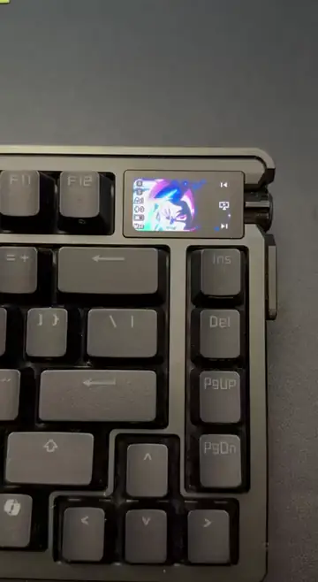

# azoth-oled-macos



Armoury Crate Gear for Mac ships the full custom animation backend for the ROG Azoth Extreme, but its interface hides the upload panel on every Mac. azoth-oled talks to the app's local server directly, so the app's own code crops the image, converts it, and writes it to the keyboard.

Not affiliated with or endorsed by ASUS. ROG, Azoth, and Armoury Crate are trademarks of ASUSTeK Computer Inc.

## Requirements

azoth-oled was tested with the following setup:

| Requirement | Tested with |
| --- | --- |
| Apple Silicon Mac (Armoury Crate Gear for Mac ships arm64 only) | macOS 27.0.1 |
| Armoury Crate Gear for Mac, running | Version 1.4.11 |
| ROG Azoth Extreme in wired mode on its USB-C cable | Firmware 3.00.11 |
| Python 3, standard library only | Python 3.9.6 |

In Bluetooth mode, the USB-C cable only charges the keyboard. Switch the keyboard out of Bluetooth mode before you upload, because Armoury Crate blocks custom uploads over Bluetooth.

## Install azoth-oled

To install azoth-oled, clone the repository and check the connection:

```bash
git clone https://github.com/farzadso/azoth-oled-macos.git
```

```bash
cd azoth-oled-macos && ./azoth-oled status
```

The `status` command prints the keyboard, the connection type, the serial number, and the active profile. The connection type must read `USB cable` before an upload can run.

## Upload an animation

To upload a GIF, run the `upload` command:

```bash
./azoth-oled upload PATH_TO_FILE
```

Replace `PATH_TO_FILE` with a GIF, PNG, JPEG, or BMP file.

The tool prints the crop and a time estimate, then shows a live progress bar. When the transfer ends, it tells the OLED to play the new animation. Keep the cable connected until the tool prints `Upload finished`.

For a first test, use the sample GIF that ships inside Armoury Crate Gear. It's exactly 184 by 97 pixels with 72 frames, and it takes about 7 minutes:

```bash
./azoth-oled upload "/Applications/Armoury Crate Gear.app/Contents/Helper/ASUS NodeJS Web Framework.app/Contents/ExternalFiles/view/6975/resources/dino-496a9.gif"
```

### Commands

azoth-oled has the following commands:

| Command | What it does |
| --- | --- |
| `status` | Shows the keyboard, connection type, serial number, and active profile. |
| `upload FILE` | Uploads an image or GIF with a progress bar, then plays it. |
| `progress` | Shows the progress bar for an upload that runs in another terminal. |
| `apply` | Plays the stored custom animation again, in about a second, with no upload. |
| `preset ID` | Plays built-in animation `ID`, from 0 to 5. |

The keyboard stores one custom animation. The `preset` and `apply` commands switch between it and the built-in animations without erasing it.

### Upload options

The `upload` command accepts the following options:

| Option | Default | Effect |
| --- | --- | --- |
| `--fit cover` | Yes | Crops the center to the panel's shape, with no distortion. |
| `--fit stretch` | No | Squashes the whole image into the panel. |
| `--frames N` | 196 | Keeps the first `N` GIF frames. 196 is the firmware limit. |
| `--profile ID` | Active profile | Saves the animation into profile `ID`. |
| `--dry-run` | Off | Prints the request without sending it. |

## Upload flow

An upload takes the following steps:

1. azoth-oled computes a centered crop with the panel's aspect ratio and posts the file to Armoury Crate Gear's local server at `127.0.0.1:1042`.
2. The app resizes each frame to 184 by 97 pixels, converts it to RGB565, and streams it to the keyboard as 64-byte HID reports.
3. azoth-oled sends the apply request that the hidden panel's **Apply** button sends, which makes the OLED play the stored animation.

The progress bar reads the app's packet log at `~/Library/Application Support/ASUS/asus.service.log`, which records every report that the app sends.

For the local API and the USB packet format, see [Protocol notes](docs/PROTOCOL.md).

## Known limitations

The following limits apply:

- **Speed:** The app sends about 110 packets per second, so each frame takes about 5.6 seconds. A 72-frame GIF takes about 7 minutes.
- **Timeout:** The app gives up on an upload after 20 minutes, which is about 200 frames. The tool warns you before an upload that long.
- **Dropped packets:** The app doesn't resend a failed HID write. Test uploads lost 0.12% to 0.18% of packets, which can show up as short streaks of wrong pixels.
- **Updates:** An Armoury Crate Gear update can change the local API and break the tool.
- **Log size:** The app logs every packet, so its log file grows to several gigabytes.
- **Dongle:** The 2.4 GHz receiver (PID 6978) is detected but untested.

## Troubleshooting

The following table lists common problems and their fixes:

| Symptom | Cause | Fix |
| --- | --- | --- |
| `status` shows Bluetooth with the cable connected | The keyboard is in Bluetooth mode, so the cable only charges it | Switch the keyboard to wired mode. |
| `cannot reach Armoury Crate Gear` | The app isn't running | Open Armoury Crate Gear. |
| The OLED shows the old animation after an upload | The apply request didn't take effect | Run `./azoth-oled apply`. |
| A preset replaced your animation | Armoury Crate Gear or `preset` switched the OLED | Run `./azoth-oled apply`. |
| Short streaks of wrong pixels | Packets dropped during the transfer | Upload the file again. |

## Development

To run the unit tests, which don't need a keyboard, run:

```bash
python3 -m unittest discover tests
```

The `tools` folder holds two scripts for checking a new Armoury Crate Gear version against [Protocol notes](docs/PROTOCOL.md):

- `tools/asar_extract.py`: Extracts the Electron helper's `app.asar` archive.
- `tools/sourcemap_extract.py`: Recovers the source files embedded in a webpack source map.

## License

azoth-oled is released under the [MIT License](LICENSE).
